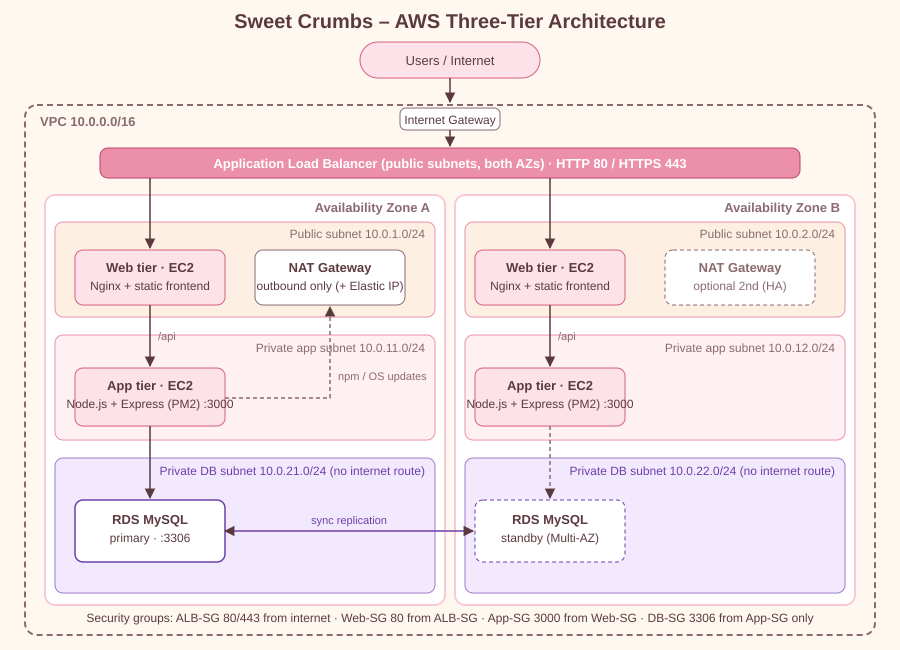
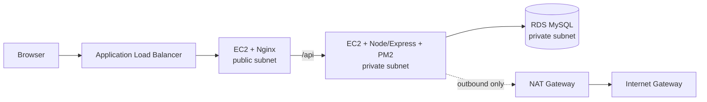

# 🎂 Sweet Crumbs – Cake Shop (Three-Tier Web App)

A dynamic online cake-ordering site: **HTML/CSS/vanilla JS** frontend → **Node.js + Express** REST API → **MySQL** (AWS RDS compatible).

* Customers: register, log in, browse cakes, use a cart, place orders, track order status.
* Admin: add / edit / delete cakes, view users, view all orders, update order status.
* Security: bcrypt password hashes, JWT in an httpOnly cookie, role-based route protection, parameterised SQL, input validation, helmet headers, login rate limiting, no secrets in frontend code.

## Project structure

```
cakeshop/
├── frontend/
│   ├── index.html  login.html  register.html  cakes.html
│   ├── cart.html   orders.html (checkout)  dashboard.html  admin.html
│   ├── css/style.css
│   └── js/  main.js  auth.js  cakes.js  cart.js  orders.js  admin.js  contact.js
├── backend/
│   ├── server.js            Express app, security middleware, health check
│   ├── seed.js              creates sample users (bcrypt) + sample orders
│   ├── config/db.js         mysql2 connection pool (env-based credentials)
│   ├── middleware/auth.js   JWT cookie auth + admin guard
│   ├── controllers/validators.js
│   ├── routes/  auth.js  cakes.js  orders.js  admin.js
│   └── .env.example
├── database/schema.sql      tables + sample cakes
├── deploy/nginx/cakeshop.conf
├── ecosystem.config.js      PM2
├── docs/  API.md  AWS_DEPLOYMENT.md  architecture.svg
└── package.json
```

(`admin.js`, `contact.js`, `seed.js`, `validators.js`, `ecosystem.config.js` are additions to the requested layout.)

Notes: the project uses **`bcryptjs`** (a pure-JavaScript implementation of the same bcrypt algorithm) so `npm install` needs no C compiler on EC2. The backend also serves `frontend/` locally, so for development you only run one process.

---

## Local installation

**Requirements:** Node.js 18+, MySQL 8 (or MariaDB 10.5+).

```bash
git clone <your-repo> cakeshop && cd cakeshop
npm install
cp backend/.env.example backend/.env      # then edit DB_USER / DB_PASSWORD / JWT_SECRET
mysql -u root -p < database/schema.sql    # creates cakeshop_db + tables + sample cakes
npm run seed                              # sample users + orders
npm start                                 # http://localhost:3000
```

Sample logins created by `npm run seed`:

| Role | Email | Password |
|---|---|---|
| Admin | `admin@cakeshop.com` | `Admin@12345` (or `SEED_ADMIN_PASSWORD`) |
| Customer | `asha@example.com` | `Customer@123` |

**Change the admin password before putting this on the internet.**

---

## Build & test in stages

### Stage 1: Database
```bash
mysql -u root -p < database/schema.sql
mysql -u root -p -e "USE cakeshop_db; SHOW TABLES; SELECT id,name,price FROM cakes;"
```
✅ You should see `users, cakes, orders, order_items` and 10 cakes.

### Stage 2: Backend ↔ MySQL
```bash
npm start                               # expect: [db] Connected to MySQL ...
curl localhost:3000/api/health          # {"status":"ok","database":"up"}
curl localhost:3000/api/cakes           # JSON list of cakes
npm run seed
```
✅ Then follow the `curl` login/register examples in [docs/API.md](docs/API.md). `GET /api/admin/users` must return **401** without login and **403** as a customer.

### Stage 3: Frontend ↔ Backend
Open `http://localhost:3000` and check:
1. Home shows featured cakes loaded from MySQL.
2. Register a new account → login → "My Account" shows your profile.
3. Cakes page: filter, search, **Add to Cart**; the cart badge updates.
4. Cart: change quantity, remove, totals update. Checkout → **Place Order** → order appears in My Account.
5. Log in as admin: add a cake, edit it, change an order's status to *Delivered*, then confirm the customer sees the new status.

### Stage 4: AWS
Follow [docs/AWS_DEPLOYMENT.md](docs/AWS_DEPLOYMENT.md) (VPC → RDS → EC2 → Nginx/PM2 → ALB). Test with `curl <alb-dns>/health` and `curl <alb-dns>/api/health`.

---

## Architecture





## Database

`users (1) ──< orders (1) ──< order_items >── (1) cakes`

* `orders.user_id → users.id`, `order_items.order_id → orders.id` (cascade), `order_items.cake_id → cakes.id` (restrict).
* `order_items.unit_price` stores the price at purchase time.
* `users.email` and `cakes.name` are `UNIQUE`.

## API summary

Full details: [docs/API.md](docs/API.md).

| | |
|---|---|
| Auth | `POST /api/auth/register` · `/login` · `/logout` · `GET /me` |
| Cakes | `GET /api/cakes` · `GET /api/cakes/:id` · admin: `POST` · `PUT /:id` · `DELETE /:id` |
| Orders | `POST /api/orders` · `GET /api/orders/my` |
| Admin | `GET /api/admin/{stats,users,cakes,orders}` · `PUT /api/admin/orders/:id/status` |
| Health | `GET /api/health` |

## Configuration (`backend/.env`)

| Variable | Purpose |
|---|---|
| `DB_HOST DB_PORT DB_USER DB_PASSWORD DB_NAME` | MySQL / RDS connection |
| `DB_SSL`, `DB_SSL_CA` | TLS to RDS (set the CA bundle path to verify the server) |
| `JWT_SECRET`, `JWT_EXPIRES_IN` | Signing secret (required, 16+ chars) and token lifetime |
| `COOKIE_SECURE` | `true` when served over HTTPS |
| `SERVE_FRONTEND` | `false` when Nginx serves the frontend |
| `SEED_ADMIN_EMAIL`, `SEED_ADMIN_PASSWORD` | Used by `npm run seed` |

## Troubleshooting

| Symptom | Likely cause and fix |
|---|---|
| `FATAL: JWT_SECRET is missing` | Create `backend/.env` from `.env.example` and set `JWT_SECRET`. |
| `[db] Connection FAILED (ECONNREFUSED)` | MySQL isn't running, or wrong `DB_HOST`/`DB_PORT`. |
| `ER_ACCESS_DENIED_ERROR` | Wrong `DB_USER`/`DB_PASSWORD`, or the user's host pattern doesn't match (see the `'cakeshop_app'@'10.0.%'` example in the AWS guide). |
| `ER_BAD_DB_ERROR` / `Table ... doesn't exist` | Run `database/schema.sql` first. |
| `ETIMEDOUT` connecting to RDS | Security group: `cakeshop-db-sg` must allow 3306 from `cakeshop-app-sg`; RDS must be in the same VPC; run the test from the app server, not your laptop (the DB is private). |
| Cakes page says "Cannot reach the server" | Backend isn't running, or Nginx `/api/` proxy/upstream IP is wrong. Test `curl localhost:3000/api/health` on the app server. |
| Login "works" but you're still logged out | `COOKIE_SECURE=true` while testing over plain HTTP: the browser drops the cookie. Use HTTPS or set it to `false` temporarily. |
| Everyone gets "Too many attempts" | Client IPs not forwarded: check the `set_real_ip_from` CIDR and `X-Forwarded-For` lines in the Nginx config. |
| `502 Bad Gateway` from Nginx | Node isn't running (`pm2 status`, `pm2 logs cakeshop`), App-SG doesn't allow 3000 from Web-SG, or SELinux blocks the proxy (`sudo setsebool -P httpd_can_network_connect 1`). |
| ALB targets "unhealthy" | Health check path must be `/health`; Web-SG must allow port 80 from the ALB's security group. |
| `npm install` hangs on the private app server | No route to the internet: check the NAT Gateway and the app route table. |
| Images show 🎂 instead of a photo | The `image_url` is unreachable (the shop falls back to an emoji). Use any public image URL or a file in `frontend/images/` (`/images/x.jpg`). |
| Cake can't be deleted | It appears in old orders, so it's hidden from the shop instead (by design, to keep order history). |
| Port 3000 already in use | Change `PORT`, or stop the other process (`lsof -i :3000`). |

Useful logs: `pm2 logs cakeshop` · `sudo tail -f /var/log/nginx/error.log` · RDS console → Logs & events.

## License

MIT
