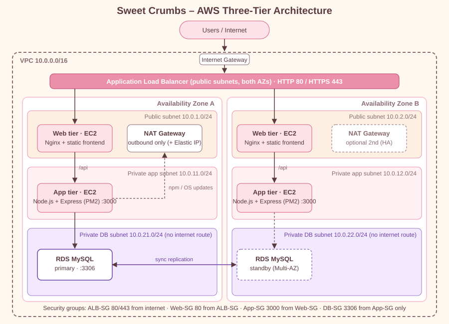

# AWS Deployment Guide (Three-Tier)

> The AWS CLI commands in this guide have **not been run against a real account** by the author. Read each one,
> change the placeholders, and prefer the console if you are unsure. Prices below are approximate: check the AWS pricing pages for your region.

## 1. Architecture



| Tier | Service | Subnet | Reachable from |
|---|---|---|---|
| Presentation | EC2 + **Nginx** (static frontend, reverse proxy for `/api`) | Public | ALB (80) |
| Application | EC2 + **Node.js/Express** managed by **PM2** (port 3000) | Private app | Web tier only |
| Data | **RDS MySQL** | Private DB | App tier only (3306) |

Request flow: Browser → ALB → Nginx → (`/api/*`) → Node.js → RDS. The browser only ever talks to one origin, so cookies work and no CORS is needed.

## 2. Networking

### CIDR plan (region example: `ap-south-1`, Mumbai)

| Subnet | AZ | CIDR | Route table |
|---|---|---|---|
| public-a | a | 10.0.1.0/24 | → Internet Gateway |
| public-b | b | 10.0.2.0/24 | → Internet Gateway |
| app-a | a | 10.0.11.0/24 | → NAT Gateway |
| app-b | b | 10.0.12.0/24 | → NAT Gateway |
| db-a | a | 10.0.21.0/24 | local only (no internet route) |
| db-b | b | 10.0.22.0/24 | local only |

### Create it with the AWS CLI

```bash
export AWS_REGION=ap-south-1
R="--region $AWS_REGION"

VPC=$(aws ec2 create-vpc --cidr-block 10.0.0.0/16 --query Vpc.VpcId --output text $R)
aws ec2 modify-vpc-attribute --vpc-id $VPC --enable-dns-hostnames $R
aws ec2 create-tags --resources $VPC --tags Key=Name,Value=cakeshop-vpc $R

mk() { aws ec2 create-subnet --vpc-id $VPC --cidr-block "$1" --availability-zone "$2" \
        --query Subnet.SubnetId --output text $R; }
PUB_A=$(mk 10.0.1.0/24  ${AWS_REGION}a);  PUB_B=$(mk 10.0.2.0/24  ${AWS_REGION}b)
APP_A=$(mk 10.0.11.0/24 ${AWS_REGION}a);  APP_B=$(mk 10.0.12.0/24 ${AWS_REGION}b)
DB_A=$(mk 10.0.21.0/24  ${AWS_REGION}a);  DB_B=$(mk 10.0.22.0/24  ${AWS_REGION}b)

# Internet gateway + public route table
IGW=$(aws ec2 create-internet-gateway --query InternetGateway.InternetGatewayId --output text $R)
aws ec2 attach-internet-gateway --internet-gateway-id $IGW --vpc-id $VPC $R
PUB_RT=$(aws ec2 create-route-table --vpc-id $VPC --query RouteTable.RouteTableId --output text $R)
aws ec2 create-route --route-table-id $PUB_RT --destination-cidr-block 0.0.0.0/0 --gateway-id $IGW $R
for s in $PUB_A $PUB_B; do aws ec2 associate-route-table --route-table-id $PUB_RT --subnet-id $s $R; done

# NAT gateway (lives in a PUBLIC subnet) + private app route table
EIP=$(aws ec2 allocate-address --domain vpc --query AllocationId --output text $R)
NAT=$(aws ec2 create-nat-gateway --subnet-id $PUB_A --allocation-id $EIP --query NatGateway.NatGatewayId --output text $R)
aws ec2 wait nat-gateway-available --nat-gateway-ids $NAT $R
APP_RT=$(aws ec2 create-route-table --vpc-id $VPC --query RouteTable.RouteTableId --output text $R)
aws ec2 create-route --route-table-id $APP_RT --destination-cidr-block 0.0.0.0/0 --nat-gateway-id $NAT $R
for s in $APP_A $APP_B; do aws ec2 associate-route-table --route-table-id $APP_RT --subnet-id $s $R; done

# DB route table: local route only (created by default) - just associate the DB subnets with it
DB_RT=$(aws ec2 create-route-table --vpc-id $VPC --query RouteTable.RouteTableId --output text $R)
for s in $DB_A $DB_B; do aws ec2 associate-route-table --route-table-id $DB_RT --subnet-id $s $R; done
```

### Security groups

```bash
sg() { aws ec2 create-security-group --group-name "$1" --description "$1" --vpc-id $VPC --query GroupId --output text $R; }
ALB_SG=$(sg cakeshop-alb-sg); WEB_SG=$(sg cakeshop-web-sg); APP_SG=$(sg cakeshop-app-sg); DB_SG=$(sg cakeshop-db-sg)
MYIP=$(curl -s https://checkip.amazonaws.com)/32

allow() { aws ec2 authorize-security-group-ingress --group-id "$1" --protocol tcp --port "$2" "${@:3}" $R >/dev/null; }
allow $ALB_SG 80  --cidr 0.0.0.0/0
allow $ALB_SG 443 --cidr 0.0.0.0/0
allow $WEB_SG 80   --source-group $ALB_SG      # only the load balancer can reach Nginx
allow $WEB_SG 22   --cidr $MYIP                # SSH only from your IP (also your jump host)
allow $APP_SG 3000 --source-group $WEB_SG      # only Nginx can reach Node
allow $APP_SG 22   --source-group $WEB_SG      # SSH to the app server via the web server
allow $DB_SG  3306 --source-group $APP_SG      # ONLY the app server can reach MySQL
```

## 3. NAT Gateway: do you need it, and what does it cost?

The app servers live in private subnets and have no public IP, so they cannot reach the internet directly.
They need outbound access for `dnf update`, installing Node/PM2, `npm install` and `git clone`. A NAT Gateway provides outbound-only access.

* **Cost (approximate, us-east-1 list price):** about **US$0.045 per hour (~US$32/month)** per gateway **plus ~US$0.045 per GB** processed, and a public IPv4 address charge. Other regions differ. Two gateways (one per AZ, for full HA) double the hourly part.
* **Cheaper options for a learning project:**
  1. Create the NAT Gateway, finish installing everything, then **delete it** (and release the Elastic IP) and re-create it only when you need updates.
  2. Build the app once (`npm ci --omit=dev`), copy the folder to the app server with `scp`/S3, and run without any internet access.
  3. Use a small NAT *instance* (cheaper, but you maintain it).
  4. S3 and other AWS services can use free *gateway* VPC endpoints instead of NAT traffic.
* The **database subnets have no route to NAT at all**: RDS never needs outbound internet.
* **Remember to delete the NAT Gateway, ALB and RDS when you finish** to stop charges.

## 4. RDS MySQL (private subnet)

```bash
aws rds create-db-subnet-group --db-subnet-group-name cakeshop-db-subnets \
  --db-subnet-group-description "cakeshop db" --subnet-ids $DB_A $DB_B $R

aws rds create-db-instance \
  --db-instance-identifier cakeshop-db \
  --engine mysql --engine-version 8.0 \
  --db-instance-class db.t3.micro --allocated-storage 20 --storage-encrypted \
  --master-username admin --master-user-password 'CHANGE_ME_Strong_Pass_1' \
  --db-subnet-group-name cakeshop-db-subnets \
  --vpc-security-group-ids $DB_SG \
  --no-publicly-accessible \
  --backup-retention-period 7 \
  $R
# add  --multi-az  for a standby in the second AZ (extra cost)

aws rds wait db-instance-available --db-instance-identifier cakeshop-db $R
aws rds describe-db-instances --db-instance-identifier cakeshop-db $R \
  --query 'DBInstances[0].Endpoint.Address' --output text      # <- your DB_HOST
```

Use a strong password. For production prefer `--manage-master-user-password` (AWS Secrets Manager) and a dedicated least-privilege MySQL user for the app (see section 7).

## 5. EC2 instances

Launch **Amazon Linux 2023** (`t3.micro` is fine for a demo) with a key pair:

| Instance | Subnet | Public IP | Security group |
|---|---|---|---|
| web-a (and web-b for HA) | public-a / public-b | yes | `cakeshop-web-sg` |
| app-a (and app-b for HA) | app-a / app-b | **no** | `cakeshop-app-sg` |

Reach the private app server by jumping through the web server:

```bash
ssh-add ~/.ssh/your-key.pem
ssh -A -J ec2-user@<WEB_PUBLIC_IP> ec2-user@<APP_PRIVATE_IP>
```

### 5a. App server (Node.js + PM2)

```bash
sudo dnf update -y
sudo dnf install -y git mariadb105
curl -fsSL https://rpm.nodesource.com/setup_20.x | sudo bash -
sudo dnf install -y nodejs
sudo npm install -g pm2

git clone https://github.com/<you>/cakeshop.git && cd cakeshop     # needs NAT (or scp the folder instead)
npm ci --omit=dev || npm install --omit=dev

# RDS CA bundle for verified TLS
sudo mkdir -p /opt/rds && sudo curl -o /opt/rds/global-bundle.pem https://truststore.pki.rds.amazonaws.com/global/global-bundle.pem

cp backend/.env.example backend/.env && chmod 600 backend/.env
nano backend/.env
```

Set at least:

```
NODE_ENV=production
PORT=3000
DB_HOST=<rds-endpoint>
DB_USER=admin
DB_PASSWORD=<your password>
DB_NAME=cakeshop_db
DB_SSL=true
DB_SSL_CA=/opt/rds/global-bundle.pem
JWT_SECRET=<output of: node -e "console.log(require('crypto').randomBytes(48).toString('hex'))">
COOKIE_SECURE=true        # only once the site is served over HTTPS (section 8)
SERVE_FRONTEND=false
SEED_ADMIN_PASSWORD=<strong password>
```

Load the schema into RDS **from the app server** (the DB is private) and seed users:

```bash
mysql -h <rds-endpoint> -u admin -p < database/schema.sql
npm run seed

pm2 start ecosystem.config.js --env production
pm2 save
pm2 startup systemd -u ec2-user --hp /home/ec2-user    # run the sudo command it prints
curl localhost:3000/api/health                          # expect {"status":"ok","database":"up"}
```

### 5b. Web server (Nginx)

```bash
sudo dnf install -y nginx git
git clone https://github.com/<you>/cakeshop.git
sudo mkdir -p /var/www/cakeshop
sudo cp -r cakeshop/frontend/* /var/www/cakeshop/
sudo cp cakeshop/deploy/nginx/cakeshop.conf /etc/nginx/conf.d/cakeshop.conf
sudo nano /etc/nginx/conf.d/cakeshop.conf        # put your app servers' PRIVATE IPs in "upstream"
sudo nginx -t && sudo systemctl enable --now nginx
curl localhost/health                             # ok
curl localhost/api/health                         # proxied through to Node
```

On Amazon Linux 2023 the default `/etc/nginx/nginx.conf` contains its own `server {}` on port 80. Comment it out if `nginx -t` complains about a conflicting default server.

## 6. Application Load Balancer

1. **Target group** `cakeshop-web-tg`: type *Instance*, HTTP 80, health check path `/health`. Register the web instances.
2. **ALB** `cakeshop-alb`: internet-facing, subnets `public-a` and `public-b`, security group `cakeshop-alb-sg`, listener HTTP 80 → `cakeshop-web-tg`.
3. Open the ALB's DNS name in a browser.

The app tier is also ALB-ready: `GET /api/health` is a deep health check (verifies MySQL). If you later add an **internal ALB** in front of the app servers, point the Nginx `upstream` at its DNS name instead of listing instance IPs.

## 7. RDS connectivity & least privilege

```sql
-- run as the RDS master user
CREATE USER 'cakeshop_app'@'10.0.%' IDENTIFIED BY 'another-strong-password';
GRANT SELECT, INSERT, UPDATE, DELETE ON cakeshop_db.* TO 'cakeshop_app'@'10.0.%';
FLUSH PRIVILEGES;
```

Then use `DB_USER=cakeshop_app` in `.env` (the master user is only for loading the schema).

Test connectivity from the app server:

```bash
mysql -h <rds-endpoint> -u cakeshop_app -p -e "SELECT COUNT(*) FROM cakeshop_db.cakes;"
nc -zv <rds-endpoint> 3306
```

## 8. HTTPS in production

1. Register/own a domain, request a free certificate in **AWS Certificate Manager** (same region as the ALB).
2. Add an ALB listener **HTTPS 443** with that certificate → `cakeshop-web-tg`.
3. Change the HTTP 80 listener to **redirect to HTTPS**.
4. Create a Route 53 alias record to the ALB.
5. Set `COOKIE_SECURE=true` in `backend/.env` and `pm2 reload cakeshop`.

TLS ends at the ALB; ALB → Nginx → Node stays inside the private VPC.

## 9. Updating the site

```bash
# app server
cd ~/cakeshop && git pull && npm ci --omit=dev && pm2 reload cakeshop
# web server
cd ~/cakeshop && git pull && sudo cp -r frontend/* /var/www/cakeshop/
```

## 10. Clean-up checklist (stop charges)

ALB and target group · EC2 instances · RDS instance (and snapshots) · NAT Gateway · release the Elastic IP · VPC.
